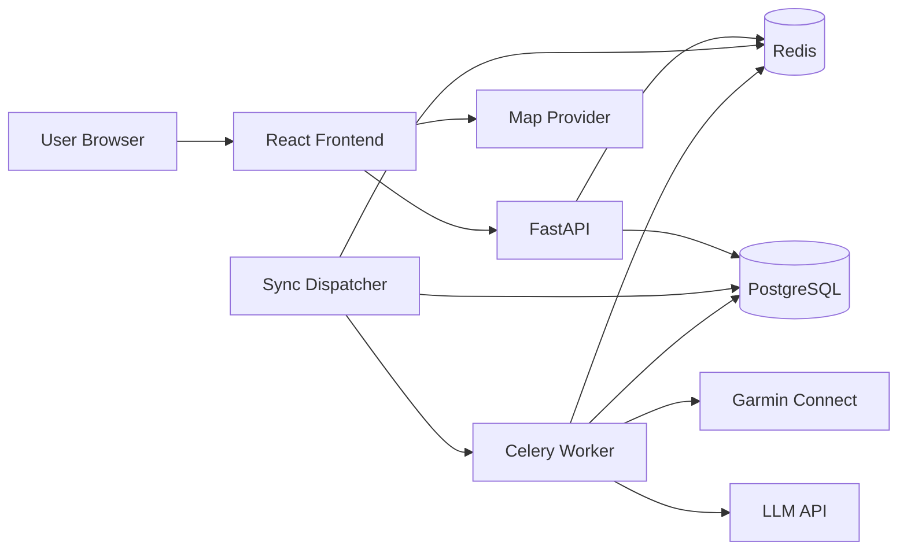
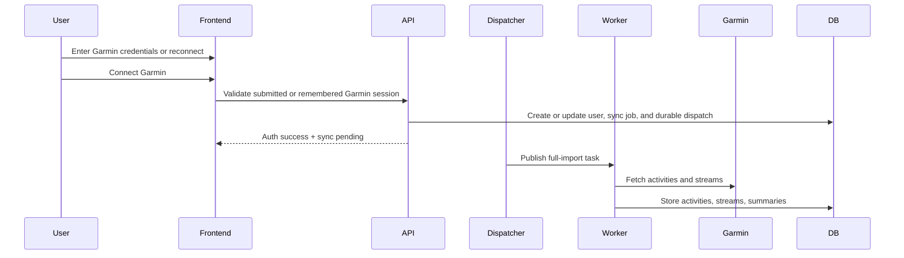

# Garmin Insights Specification

## Purpose

Garmin Insights is a desktop-first web application for athletes who want fast analytics over their Garmin Connect
activity history without depending on live Garmin reads during normal app use. The system imports Garmin data into local
storage, computes derived metrics, and serves dashboards and activity detail views from the local database and cache.

## Documentation Roles

- `docs/specification.md`: source of truth for product scope, architecture, constraints, and required behavior
- `docs/implementation_plan.md`: source of truth for implementation status and remaining work
- `docs/development.md`: source of truth for local setup, validation commands, and day-to-day development workflow

## Product Scope

### Core Requirements

- Authentication connects a user's Garmin account with Garmin email/password and stores only encrypted session material
  after successful validation.
- Before a user can connect, the landing/login screen must collect that user's Garmin credentials or offer reconnect
  through remembered encrypted session material.
- The system supports multiple users with isolated data.
- Supported sports in v1 are running, cycling, and e-bike ride types; strength-training activities are omitted.
- First login triggers a background full historical import.
- Ongoing synchronization runs daily, with optional refresh on startup when data is stale.
- Users cannot export, delete, or disconnect their data in v1.
- A single admin athlete with source athlete id `632291` by default can review user access and disable other users.
- Historical edits and deletions performed later in Garmin Connect are out of scope for v1.
- Imported streams are sanitized before persistence so impossible speed, distance, GPS, altitude, and heart-rate samples do not contaminate reads or analytics.
- Activities of the same sport sharing a locally matched GPS route can be compared from local data.
- Activities imported after the initial history import receive an AI coaching note, and weeks and months containing
  such activities receive an AI coaching review (see AI Coaching).
- Desktop is the primary target. Mobile optimization is not required for v1.

### Required Screens

- landing/login
- dashboard
- calendar
- activity list
- activity detail
- best efforts
- settings/profile
- admin users/audit
- sync/import status

## Performance and Operational Requirements

- Normal UI reads should complete within 500 ms when served from local storage or cache.
- Standard page rendering must not depend on synchronous Garmin Connect API calls.
- Activity detail must be renderable from locally stored activity and stream data.
- Duplicate activities must be upserted by `(source_provider, source_activity_id)`. Garmin numeric activity IDs are
  retained as their source activity IDs.
- Daily and manual syncs update derived data (period summaries, best efforts, route groups) incrementally for newly
  imported activities only. Recomputing the whole history is reserved for the explicit "Recalculate All" action, a full
  import, and derived-model version changes.
- Token expiry during sync must reuse and persist the refreshed Garmin session. A final Garmin authentication rejection
  must mark the connection as requiring reauthentication, stop scheduled syncs, and preserve imported data until the
  user reconnects and manually starts a sync.
- Sync commands must be recorded durably before Celery publishing. Temporary broker and Garmin Connect failures retry
  with exponential backoff before a sync job is marked failed.
- Partial import failure for one activity must not corrupt already persisted valid data.

## Technology and Delivery Constraints

### Target Stack

- Frontend: React, Tailwind CSS, Recharts, Mapy.cz-backed map rendering
- Backend: Python 3.13, FastAPI, uv
- Worker: Celery, uv
- Logging: Docker console output for backend and worker services
- Database: PostgreSQL
- Cache and broker: Redis
- Local validation: Docker Compose driven through short `make` targets

### Local Workflow Requirements

- Docker is the standard local validation environment.
- The repository must expose short task entrypoints such as `make build`, `make up`, `make test`, and `make down`.
- Windows is the primary local environment, so command design must remain Windows-compatible.
- Every meaningful iteration should be validated locally.
- Every meaningful code change must include a successful build validation.
- Do not rely on deleting or recreating the database as a normal development step.
- When schema changes are required, add explicit backward-safe migrations.

## Administration

- The admin identity is fixed to the configured athlete whose stored source athlete id is `632291` by default.
- The admin screen must show all users with basic audit fields: display name, source athlete id, active status, created/updated timestamps, and last login timestamp.
- The admin can disable any non-admin user.
- A disabled user must be blocked from further app use and from reconnecting through Garmin credentials.
- The admin account cannot disable itself.

## Architecture

### Target Structure

- `frontend`: React web application
- `backend`: FastAPI application for auth, read APIs, profile management, and sync orchestration
- `worker`: Celery worker for full import, incremental sync, read-model refresh, and AI coaching generation
- `beat`: Celery beat scheduler for daily sync orchestration and periodic AI coaching generation
- `sync-dispatcher`: durable-outbox publisher that retries Celery task publication independently of request handling
- `postgres`: source of truth for persisted application data
- `redis`: cache plus Celery broker/backend

### Architectural Rules

- Keep framework code at the edges.
- Keep business logic in testable domain and application layers.
- Isolate infrastructure concerns such as Garmin Connect access, persistence, cache, and background jobs.
- Avoid coupling UI code, HTTP handlers, and persistence logic directly.
- Maintain clear separation between auth, sync, analytics, and read APIs.
- Keep read APIs reusable so future machine-consumable or insight-oriented endpoints can be added without major redesign.
- Emit readable service logs to container stdout.

## Frontend Direction

The frontend should feel closer to a modern athlete training platform than to a generic admin dashboard.

### Visual Direction

- clean, bright, metric-first presentation
- light primary surfaces
- dark or charcoal text for primary numbers and labels
- orange accent for active controls, emphasis states, and cycling-related indicators
- restrained neutral grays for borders, dividers, and secondary text
- large KPI numbers with compact labels
- rounded cards and controls without over-soft consumer styling
- simple layouts with generous whitespace and minimal decoration

### Avoid

- dark default product surfaces
- neon gradients or glass-heavy styling
- decorative effects that compete with metrics
- arbitrary color systems unrelated to sport meaning

## Analytics and Read Requirements

### Global Analytics Scope

The application must support:

- progression over time
- pace or speed trends
- elevation trends
- training-load-oriented trends
- best efforts
- monthly, yearly, and rolling comparisons
- single-activity analysis

### Shared Filters

- sport type
- date range

### Activity List Filter

The activities view adds a local filter on top of the shared filters. It narrows the already loaded activity list in the
browser and does not issue extra API requests.

- case-insensitive substring match on the activity name
- KPI rules with `>`, `<`, or `=` operators, combined with AND
- KPIs: distance (km), moving time (min), elevation gain (m), average heart rate (bpm), aerobic efficiency (m/beat),
  and pace (min/km) or speed (km/h)
- pace is offered only when the loaded activities use pace as their summary metric and speed only when they use speed,
  so the choice follows the selected sport; a pace or speed rule only matches activities with that summary metric
- `=` compares at the precision shown in the UI; activities missing the filtered KPI are excluded
- filter state is not persisted and resets when leaving the activities view

### Activity Rename

- the activity detail header shows a pen button next to the name that switches the title into an inline input with
  save and cancel actions (Enter saves, Escape cancels); no overlay is used, so the Leaflet map is unaffected
- the name is trimmed, must be non-empty, and at most 255 characters
- renaming is local only and is not pushed to Garmin Connect
- imported activities are treated as immutable: Garmin sync sets the name only on first import and never overwrites
  the name of an existing activity, including when it re-imports an activity to backfill missing streams, so local
  renames are preserved without a separate flag

### Dashboard Comparison Windows

- current week versus previous week
- current month versus previous month
- current year versus previous year
- rolling 30 days versus previous rolling 30 days

Supported comparison selectors:

- `week`
- `month`
- `year`
- `rolling_30d`

### Comparison Metrics

- total distance
- total moving time
- activity count
- average running pace for running activities
- average cycling speed for cycling activities

Rules:

- comparisons must honor the selected sport filter
- period pace and speed must be derived from aggregated totals, not from averaging per-activity averages
- running pace is `total_moving_time / total_distance`
- cycling speed is `total_distance / total_moving_time`

## Activity Data Requirements

### Imported Activity Fields

At minimum, imported activity metadata must support:

- `id`
- `name`
- `description`
- `start_date_local`
- `type`
- `distance`
- `moving_time`
- use Garmin's moving pace/speed fields when provided; otherwise derive average pace or speed from moving time,
  excluding pauses represented by elapsed time
- `elapsed_time`
- `total_elevation_gain`
- `average_speed`
- `max_speed`
- `average_heartrate`
- `average_cadence`

### Imported Streams

When available, the system must persist streams needed for local detail rendering:

- `time`
- `distance`
- `latlng`
- `altitude`
- `velocity_smooth`
- `heartrate`

Garmin positional activity-detail metrics must be normalized from their descriptor keys (including `sumDuration`,
`sumDistance`, `directLatitude`, `directLongitude`,
`directElevation`, `directHeartRate`, and `directSpeed`) before persistence.

Imported and previously stored streams must be sanitized without changing sample-array alignment:

- invalid samples become null rather than being removed
- distance remains non-negative and monotonic, with impossible increments corrected
- negative or sport-impossible speed is removed
- invalid coordinates and impossible GPS jumps are removed
- impossible altitude and heart-rate jumps are removed
- GPS null runs split route rendering into separate map segments

### Normalized Read Fields

Backend read models and API payloads should expose at least:

- `distance_km = distance / 1000`
- formatted moving time
- running pace when applicable
- cycling speed in `km/h`
- route polyline and map bounds when GPS data exists

## Activity Summary KPIs

Activity summary surfaces and detail headers must expose:

- distance in kilometers
- moving time
- running pace for running activities or speed for cycling activities
- total elevation gain
- average heart rate when available

Formatting rules:

- `distance_km = round(distance / 1000, 2)`
- moving time is `M:SS` below one hour and `H:M:SS` for longer durations
- running summary pace is displayed as `min/km`
- cycling speed is displayed in `km/h`
- elevation is displayed in meters
- heart rate is displayed in bpm

If heart-rate data is missing, the API must return a nullable value and the frontend must omit or soften that KPI without failing the page.

## Best Efforts

### Functional Scope

Best efforts should be available for:

- running
- ride
- e-bike ride

The implementation should remain extensible to new effort distances and sport categories without schema rework.

### Record Requirements

Each best-effort record should retain at least:

- user id
- sport type
- effort code or canonical distance label
- best time
- source activity id
- source activity date

For every configured sport and distance, the read model retains the five fastest efforts ordered by time. Rank is derived from that ordering rather than stored separately.

Implementation rule:

- derive best efforts locally from persisted sanitized activity streams
- derive running and cycling efforts with a linear sliding-window algorithm over sanitized local streams
- show rank 1 by default on the Best Efforts screen and allow expanding ranks 2 through 5
- link every effort to its originating local activity
- show all top-five efforts owned by an activity in Activity Detail

## Activity Detail Requirements

### Required Elements

- activity metadata and KPI summary
- route map based on stored GPS points
- pace for running or speed for cycling
- heart rate when available
- elevation when available
- slope when available
- hover-linked active marker on the map driven by graph focus
- average lines plus AeT and AnT guides on pace and heart-rate charts when thresholds are available
- detail-chart axis scaling may ignore abnormal first and last source samples for presentation while preserving their
  original values for tooltips and linked interactions; interior samples must remain visible so interval sessions retain
  their full range
- detail-chart tooltips must remain inside the chart bounds by choosing above or below placement and left, center, or
  right alignment from the active point position
- cycling analysis for ride and e-bike ride activities using available speed, heart-rate, cadence, and terrain data
- top-five best-effort ranks owned by the activity
- a same-route comparison when at least two local activities of the same sport match by sanitized GPS geometry
- threshold-based running analysis for running activities when user thresholds are configured

The activity detail page may replace legacy running-analysis behavior when a clearer product-specific model is chosen.

### Detail Payload Requirements

The backend detail payload must include:

- metadata and KPI values
- map bounds and route polyline when GPS is present
- distance-aligned series for pace or speed
- distance-aligned heart-rate series when present
- distance-aligned elevation series when present
- distance-aligned slope series when derivable
- recorded lap metrics and split-import availability state
- configured AeT and AnT threshold values when available for the user and activity
- cycling-analysis output when applicable
- running threshold-analysis output when applicable
- ranked best efforts owned by the activity
- local route-comparison attempts, rank, personal best, and difference when available

Route comparison behavior:

- derive route identity locally from persisted sanitized GPS streams; do not call a premium source route API
- compare only activities with the exact same sport type
- preserve route order and direction, so a reversed route is a different route
- treat same-direction closed loops as the same route when the recording starts at a different point on the loop
- tolerate normal GPS jitter and short missing runs while keeping genuine shortcuts and detours separate
- require at least 20 valid coordinate pairs, at least 80% valid GPS samples, at least 500 meters of route distance, and no unbridgeable GPS gap over 200 meters
- resample routes at 50-meter spacing with at most 500 signature points
- prefilter candidates by H3 resolution 9 cells and a maximum 5% activity-distance difference
- require bidirectional 95% route coverage within 75 meters, a maximum 150-meter Hausdorff distance, and a maximum 125-meter ordered Frechet distance
- require open-route start and finish points to remain within 150 meters; closed loops are start-position invariant but direction-sensitive
- build deterministic complete-link groups so an activity must match every existing member before groups merge
- rank by moving time
- display the fastest five attempts plus the current activity initially
- allow expanding the complete local attempt history
- include date, moving time, pace or speed, average heart rate, distance, and an activity link
- show a moving-time trend over the locally stored attempts
- render activity-owned best efforts in the top KPI grid as one icon-led tile spanning the four columns remaining after Avg HR and Efficiency
- show every best effort owned by the activity inside that tile, ordered by distance, with rank, distance, time, and pace or speed
- present efforts in one horizontal row on desktop, with PB in orange, rank two in silver, rank three in bronze, and ranks four and five in the neutral text color
- render the ranked route-attempt table and trend in a separate `Matching Routes` card after the slope chart, styled like the other detail cards
- keep the route map limited to the current activity rather than overlaying matched attempts
- avoid a separate route title or summary panel because the ranked table already identifies the current attempt and personal best
- omit route comparison when GPS is ineligible or fewer than two local activities belong to the route group

### Recorded Splits Chart

- Recorded splits primarily supply compact input for AI activity coaching; the chart displays the same normalized data.
- Add one `Splits` chart immediately above the existing slope chart.
- Use Garmin's recorded lap boundaries, including auto-laps and manual/workout laps as exposed by the activity.
  Preserve their recorded lengths; do not generate kilometer boundaries from current device settings or substitute
  fixed-distance splits derived from the activity streams.
- Plot average running pace, or average speed for rides and e-bike rides, as a filled flat step across each lap's
  distance range, with pace/speed on the left axis. Show average HR only in the split tooltip and coaching payload.
- Keep only the `Splits` title above the graph; omit pace/speed and elevation legend labels.
- Keep the continuous elevation area behind the split series, using the same local altitude stream as the other
  detail charts, with the same gray elevation scale on the right axis. Give elevation an independent scale so it
  cannot change the pace/speed scale.
- Keep cumulative distance in kilometers on the horizontal axis; lap widths must reflect actual distances.
  Preserve the final partial lap. Retain zero-distance laps in the payload without inventing a visible distance width.
- Show lap number, available lap type, distance range, duration, average pace/speed, and average HR in a bounds-safe
  tooltip. Show the elevation at the focused distance when available.
- Link chart focus to the existing map and other graphs by distance and the original stream index. Do not equate
  lap indices with stream indices. Reflect focus from other charts in the containing lap.
- Missing HR omits that tooltip value; missing elevation omits its area and axis. Invalid lap metrics remain gaps rather than zero
  values. Activities without usable distance-based splits show a compact unavailable state.
- Fetch and persist splits only while importing a new Garmin activity, using the existing import session.
  Activity-detail reads use local data only. Normalize the provider payload at the Garmin adapter boundary,
  with calculation/validation in testable application code.
- Attempt splits once per new activity; empty responses or non-authentication failures make splits unavailable
  without blocking import. Authentication failures use the existing reconnect flow before inserting the activity.
  No separate polling job, retry state, or historical backfill is required. Refresh, recalculation, and stream-only
  backfill do not fetch splits for existing activities. Preserve existing splits, activity data, notes, and plans.
- Import chronological `lapDTOs` from Garmin's activity `/splits` endpoint. Use `averageSpeed` based on Garmin's
  timer duration (excluding timer stops but retaining timed recoveries), with lap distance divided by `duration`
  as the fallback. Do not substitute `averageMovingSpeed`, which can exclude low-speed recoveries. Persist timer,
  moving, and elapsed durations separately; derive running pace from the selected positive average speed.
- Use these persisted laps as the within-activity input for coaching, replacing stream-derived fixed-distance splits
  and any stream excerpts. Send each lap's number/type when available, distance, duration, average running pace or
  cycling speed, and average HR. Do not send the elevation profile or per-sample data; elevation remains a UI series.
  Activity-level elevation gain may remain in the activity KPIs.
- Ensure split fetching is attempted before a new activity's coaching note is queued. If splits are unavailable,
  generate from available activity context with an explicit split-data limitation; do not silently substitute stream excerpts or invented laps.
- Retain useful existing activity KPIs, thresholds, local aggregate analytics, and recent-training context. Prompts
  must describe the actual split payload and avoid claims about within-lap surges, terrain effects, or HR evolution
  that lap averages cannot establish. Existing ready coaching notes are not regenerated by split import changes.

### Canonical Derived Series

For v1, these are the canonical activity-detail derivations:

- `distance_km` comes from stream distance values in meters
- heart rate uses sanitized imported samples without an additional moving average
- speed uses sanitized imported `velocity_smooth` samples converted to `km/h` without an additional moving average
- running pace uses the adjacent stream `time` and `distance` samples
- running pace values are capped at `16 min/km`
- running pace must be available both as numeric `min/km` and display-ready `MM:SS /km`
- slope uses altitude change over a 30-point window divided by horizontal distance and converted to percent
- slope values are clamped to `[-45, 45]`

Current pace derivation behavior to preserve:

- for the first point, `start_index = 0` and `end_index = min(len(stream) - 1, 1)`
- for later points, `start_index = i - 1` and `end_index = i`
- `pace_min_per_km = delta_time_minutes / delta_distance_km`

If `delta_distance` is zero, pace should be treated as infinite and legacy-compatible formatted output should render `0:00`.

## Running Threshold Analysis

### Profile Inputs

Running threshold analysis should use explicit user-configured threshold snapshots when available.

Threshold snapshots must:

- store the full AeT/AnT HR and pace set together
- include an `effective_from` date
- be resolved for activity detail by the activity local calendar date, choosing the latest snapshot whose `effective_from` is on or before that date

Each snapshot includes:

- `aet_heart_rate_bpm`
- `ant_heart_rate_bpm`
- `aet_pace_min_per_km`
- `ant_pace_min_per_km`

### Band Rules

For pace and heart rate independently, classify each aligned running detail point into:

- `below_aet`
- `between_aet_ant`
- `above_ant`

Rules:

- `below_aet` means value is below the configured aerobic threshold
- `between_aet_ant` means value is at or above `AeT` and below `AnT`
- `above_ant` means value is at or above `AnT`

### Running Analysis Output

For running activities with complete threshold inputs and heart-rate plus pace series, the backend should return a structured threshold-analysis payload that includes:

- pace distribution across the three bands
- heart-rate distribution across the three bands
- pace-vs-heart-rate agreement share
- mismatch shares where pace intensity is higher than heart-rate intensity and vice versa

This is descriptive analysis, not prescriptive coaching.
Pace intensity above heart-rate intensity for more than half of the run can be treated as a positive condition or freshness signal when route, weather, intent, and heart-rate data quality are comparable. Heart-rate intensity above pace intensity for more than half of the run should be treated as a strain warning rather than an improvement signal. Interval-like sessions must be evaluated with the expectation that tempo and heart rate change repeatedly and that heart rate can lag behind pace changes.

The running-analysis UI should:

- show compact question-mark help affordances beside each metric label
- use those tooltips to explain what each metric means and how to read it
- show a green improving-condition icon beside `Pace Above HR` when its share is above 50%
- show a red decreasing-condition warning icon beside `HR Above Pace` when its share is above 50%

## Cycling Analysis

For ride and e-bike ride activities, the backend should return a structured cycling-analysis payload when speed data is available.

The first cycling-analysis version should use only currently stored data:

- ride speed distribution using session-relative speed bands
- heart-rate distribution across `below_aet`, `between_aet_ant`, and `above_ant` when HR thresholds and HR data are available
- climbing, flat, and descending distance share from slope-derived terrain classification
- average cadence when available on the activity

Cycling speed should not be treated as a physiological threshold proxy in the way running pace is.

## Missing Data Behavior

- The activity detail page must still load when core activity metadata exists.
- Missing heart-rate data must hide heart-rate KPIs and related graph content without failing the page.
- Missing GPS data must hide the route map and hover-linked marker behavior.
- Missing or ineligible GPS route signatures must hide route comparison without affecting activity detail.
- Incomplete GPS coordinate streams, including scalar-only or null-containing Garmin stream data, must be treated as
  missing GPS data unless valid `[latitude, longitude]` pairs are available.
- Missing altitude data must hide elevation and slope visualizations.
- Sparse null samples inside numeric streams must not fail activity detail rendering; valid numeric samples should remain usable for charts and analytics.
- Slope must only be computed when both altitude and distance streams are available.
- If an activity is only partially imported, valid local data must remain readable.

The UI should omit unavailable widgets rather than showing placeholder errors.

## Calendar Requirements

### Monthly View Behavior

- render one visible cell per day
- aggregate all activities in a day into one daily summary marker
- use the sum of same-day activities as the daily total
- allow drilling into the activities for the selected day

### Daily Marker Rules

- use one circular marker as the primary daily encoding
- marker diameter scales with total daily distance in kilometers
- days with greater total distance must render larger circles
- days with no completed activities show no activity marker, including days with a planned workout or rest day

### Daily Color Rules

- running days use yellow
- cycling days use orange
- mixed-sport days use the color of the sport contributing the greater distance share

The calendar should feel closer to a training overview than to a traditional enterprise calendar widget.

### AI Running Plans

- The planning objective is sustained improvement in running performance: aerobic threshold (AeT), anaerobic
  threshold (AnT), endurance, and speed. Threshold improvement means being able to sustain a faster pace at the
  relevant physiological intensity; raising the target heart rate is not itself evidence of improvement.
- Each seven-day plan is the next part of an ongoing progression informed by multiple weeks of completed training
  and previous plans. Balance easy aerobic running, longer endurance runs, appropriately dosed threshold/speed
  work, and recovery according to the athlete's current capacity and response.
- Increase training load or intensity only when recent training and recovery evidence supports it. Holding or
  reducing load, including recovery weeks, is part of progression; do not make every successive plan harder.
- Before assigning daily workouts, choose and persist a `build`, `maintain`, or `recover` objective with a reason,
  supporting evidence, a target weekly distance band, usual running frequency, a long-run range, and a review date.
  Use completed training as the capacity baseline; an earlier undersized AI plan must not lower it.
- With stable comparable aerobic performance and at least three prior active weeks, `build` targets a modest
  2–6% increase over the larger of the latest week's volume and the mean of latest/typical volume. Otherwise,
  `maintain` normally targets 95–105% of that mean, consolidating a recent volume increase before adding more load.
  Typical volume is the median active-week distance from the latest four seven-day blocks.
- An isolated adverse aerobic pace/HR comparison calls for local recovery and moving/reducing quality work while
  preserving the weekly objective. At least two adverse recent dates, a material all-sport load spike or hard-session
  concentration, or a return after inactivity can select `recover`. Compare only aerobic runs of similar distance
  and available terrain, with at least two historical reference sessions: HR at least 5 bpm higher at similar pace,
  or pace at least 5% slower at similar HR, is a possible fatigue indicator rather than a diagnosis. Missing
  comparative evidence favors maintaining volume rather than assuming improvement or fatigue.
- Recovery normally targets 60–80% of the latest/typical volume mean with easy running and rest. A return after a
  week without running allows a smaller easy plan. All target ranges must fit the athlete's volume, run-distance,
  and frequency ceilings, including feasibility when a recovery objective reduces the number of running days.
- Activity-triggered rolling forecasts retain the current block's objective and review date until review is due;
  new recovery evidence may lower the objective mid-block without restarting its review clock. Preserve the
  normal running frequency and long-run stimulus instead of spreading reduced mileage over more short runs.
- Give each planned run a short purpose explaining its contribution to endurance, AeT, AnT, speed, or recovery.
  Account for cycling fatigue when choosing running intensity and recovery spacing, and preserve continuity of
  the training progression when regenerating future workouts after an activity.
- Assess progress from comparable local evidence, such as pace at similar HR/intensity, sustained running
  distance/duration, and speed over comparable efforts. Distinguish observed trends from intended adaptations;
  do not promise improvement every week or automatically change configured thresholds based on generated targets.
- Generate AI running plans for the next seven days after new activities are imported. Existing coverage shrinks
  between imports; maintaining seven future planned days on inactive days is not required.
- Allow at most one planned running workout per user per date.
- Each planned run has one distance target in kilometers, one pace target displayed as `min/km`, and one
  heart-rate target in bpm; targets are single values rather than ranges or zones.
- Workout creation is AI-only; manual entry and manual editing are outside this feature's scope.
- Persist plans separately from imported activities. Planned values must not contribute to completed-activity
  totals, best efforts, or other historical analytics.
- Generate plans in background jobs using local training history and configured thresholds. Calendar reads must
  use stored plans without calling Garmin or the model.
- Generate the first plan after the initial historical import, provided recent training supports usable targets.
  Subsequently, request one recalculation after a successful sync imports new supported activities, regardless of
  how many activities were imported. Running, cycling, and e-bike activities all trigger recalculation because they
  affect fatigue and recovery; the generated workouts remain running-only.
- Calendar visits, date rollover, syncs without new activities, reimports of existing activities, threshold edits,
  and prompt/model configuration changes do not independently trigger recalculation. Use current thresholds and
  planning configuration on the next activity-triggered request.
- Rest days preserve existing targets. As dates pass, future coverage shrinks and eventually becomes empty if the
  athlete does not train. Background polling may recover or retry an existing request but must not create a new
  plan solely because the date or other inputs changed.
- An explicit operator CLI `replan` command may request a new plan without a new activity. Provide a corresponding
  `make ai-plan-replan` shortcut. This uses the same durable generation, validation, and retry path as automatic plans.
- Plans cover tomorrow through seven days from the generation context date, using configurable `PLANNING_TIMEZONE`
  (default `Europe/Prague`). Persist one run/rest row per date and publish validated future targets atomically;
  past targets and existing targets during a pending/failed regeneration remain readable.
- Require at least three running activities in the last 42 days, one within 14 days, and running HR observations or
  an AeT HR threshold. Otherwise expose an insufficient-data state. Without both HR thresholds, allow easy running
  only and use available running HR observations to bound targets.
- Bound planned volume to 110% of the largest completed seven-day running volume in the latest four seven-day
  blocks, and any run to 110% of the longest run in the last 28 days. Allow at most six running days, at most one more
  running day than the athlete's highest recent weekly frequency, and at most two quality days. At least 70% of
  planned distance must be easy. Leave an intervening recovery day between quality sessions and between planned
  quality work and recent/planned long runs; include hard cycling/e-bike activities in recovery checks. These are
  ceilings, not progression targets. The selected objective supplies narrower volume and long-run ranges and the
  usual running-day count; reject responses outside them and require quality work in a build block when thresholds
  and established frequency support it. All-sport time rising more than 30% above the median prior active-week load,
  or at least three hard days in the last week, supports recovery. Allow easy running only after a week without
  running. Easy pace must respect the configured AeT pace or the observed recent median
  running pace when no AeT pace is configured, and easy HR must remain at or below its baseline.
- Expose plans through an authenticated local read API. Calendar cells show planned sessions only from today onward,
  using the browser's local date; past run and rest targets remain stored but are hidden in the calendar.
  Calendar cells show planned distance, pace, and HR or rest,
  with the purpose always visible above the targets, without expand/collapse controls. Running plans follow the running/all-sports filter and remain separate from actual
  activity markers. Show pending, failed, insufficient-data, and previous-target states without blocking the calendar.
  A ready plan shows no informational text bar above the calendar.
- Include the objective and explanation in plan API metadata and CLI `replan`/`show` output. This does not add a
  ready-state information bar to the calendar. Store objective metadata in the existing request JSON so older
  requests remain readable without a schema migration; upgrade pending legacy contexts within their requested dates.

## AI Coaching

### Scope

- Every activity newly imported by an incremental sync (daily, manual, or reconnect refresh) gets one activity coaching
  note. The initial full historical import does not create notes.
- An operator can queue notes for a user's latest activities through the worker CLI; this is how existing data is
  tried out without a backfill.
- Every week (Monday-based) and calendar month that contains at least one activity with a ready note gets one coaching
  review. Reviews cover all activities in the period, including activities without a note.

### Content

- Output language is English, written as a coach addressing the athlete directly, grounded only in the supplied data.
- Notes and reviews are analyses, not retellings: they judge training quality (execution of the session's purpose,
  pacing, heart-rate response, zone distribution), fatigue (heart-rate drift, fading pace, heart rate versus recent
  similar sessions, load and rest days), and trends against recent training, and derive recommendations from that.
- An activity note contains a `description` (three short analysis paragraphs: quality, fatigue, trends), a `summary`
  (at most about 40 words with the analytic verdict, derived from the description in the same model answer and reused
  as input for period reviews), and a `recommendation` for the next training session(s).
- A period review contains a `summary` analysing the week or month and a `recommendation` for the next period, or for
  the rest of the period while it is still in progress.
- Prompt input is limited to local data: activity KPIs, split averages, heart-rate zone shares and thresholds,
  aerobic decoupling, best-effort ranks, route comparison, recent training, and previously generated summaries.
  Within-activity evidence comes from persisted recorded Garmin laps containing distance, timer duration, average
  pace or speed, and average HR; the activity prompt describes the limits of these lap averages.
  GPS coordinates, elevation profiles, and raw or downsampled stream excerpts are not sent. Local streams may still
  be used to calculate existing aggregate metrics without including their samples in the model request.
- Provider payloads use compact JSON. Activity contexts omit weekday, local start time, maximum speed, and
  elapsed time when it equals moving time. Distances, lap durations/speeds, and cadence use bounded precision.
  Planning sends rounded historical activity metrics and omits prior plan rationales while retaining session
  dates, types, and targets. Stored planning context and validation bounds retain their original precision.
  These reductions apply to subsequent calls, including queued planning retries, without regenerating ready text.
- Garmin's own activity description is never overwritten; coaching text is stored separately.

### Generation Model

- The model is reached through Groq's official synchronous Python SDK using JSON-object chat completions. The default
  model is `openai/gpt-oss-120b`; model, API key (`LLM_API_KEY`), and timeout are worker configuration. Without an
  API key, generation is skipped and queued work waits. SDK retries are disabled so durable work items own retries,
  and notes/reviews are capped at 2,048 completion tokens; seven-day plans use 4,096. Provider error bodies are not
  stored or logged.
- Coaching rows are durable work items: notes are queued in the same transaction that persists the new activity, and
  period reviews are queued by a planner that compares a hash of the period inputs with the inputs of the last
  review.
- Generation runs in the worker right after a sync that imported activities and periodically from `beat`. Workers claim
  rows with leases so concurrent runs never generate the same item twice.
- Notes for a user are generated only after that user's sync job finishes, so best efforts and route groups already
  include the new activity. A period review waits until no note in that period is still pending.
- A period review is regenerated when its inputs change and once more after the period ends, so every finished period
  ends with a final review.
- Rate-limit responses defer the item until the provider's retry delay without counting an attempt and stop the
  current run. Other failures retry with exponential backoff and become `failed` after five attempts; a failed
  review is retried only when its inputs change.
- Each run is capped by a configurable call budget to stay within provider request and token quotas.
- UI read paths only read stored coaching rows and never call the model. Existing text stays visible while a
  regeneration is pending.

### Presentation

- Activity detail shows the coaching note below the running or cycling analysis with the summary, description, and next-session advice,
  or a pending or failed state.
- The calendar shows the month review and the week reviews overlapping the displayed month below the grid, marking
  reviews of unfinished periods as in progress.

## Sync Model

- First login enqueues a full historical import.
- Creating a sync job and its `sync_dispatch_outbox` command must commit atomically before any broker publication is
  attempted.
- The sync dispatcher leases pending commands, retries failed task publication with exponential backoff, and marks a
  command dispatched only after Celery accepts it.
- Sync task delivery is at least once; workers must claim a queued sync job before importing so duplicate deliveries are
  harmless.
- Temporary import failures retry with bounded exponential backoff. Final Garmin authentication rejection requires
  reconnection rather than retry.
- Users can use the app while import is running and see sync progress.
- Daily refresh imports only newly available activities.
- Manual refresh is incremental only and must not trigger a full reimport.
- New data invalidates affected cache entries and recomputes summaries as needed.
- Manual refresh backfills missing or empty streams for already-imported activities without reimporting populated
  streams.
- Settings offers a "Recalculate All" action that queues an incremental sync with source `full_recompute`.
- Deletions and later historical edits in Garmin Connect remain out of scope for v1.
- If a sync checkpoint is missing, incremental sync should fall back to the latest locally stored activity timestamp rather than reimporting full history.
- If Garmin activity streams return `404`, import the activity and continue without streams.

### Derived Data Updates

Activities are only ever added by sync. Derived data is therefore maintained incrementally, and the full recomputation
is the single source of correction.

Full recomputation runs when any of these holds:

- the sync job is a `full_import`, or its source is `full_recompute`
- the versioned `analytics_model` checkpoint (period summaries, stream sanitization, best efforts) or the `route_model`
  checkpoint is missing or stale; each part rebuilds independently
- the `derived_activities` watermark checkpoint is missing

A full recomputation re-sanitizes persisted streams, rebuilds period summaries and the top-five best efforts from all
activities, rebuilds every route signature and group, and replaces the stored rows.

Every other sync processes only pending activities: activities whose id is above the `derived_activities` watermark
(the highest activity id already processed) plus activities whose streams were backfilled in this sync.

- Streams are sanitized once when they are imported; the incremental path does not re-sanitize history.
- Period summaries are rebuilt from activity rows only, without loading streams.
- Best efforts are computed for pending activities only and merged into the stored top five per sport and distance.
  Because activities are never removed, the result equals a full recomputation.
- Route matching builds a signature for each pending activity and loads candidate signatures from
  `activity_route_signatures`: same user and sport, comparable distance, and spatial cells overlapping the H3
  neighbourhood of the new signature. Streams of existing activities are not loaded.
- A pending activity joins the existing route group whose every member matches it (complete linkage, the same rule as
  the full grouping). When several groups qualify, the highest average similarity wins, then the lowest group id.
  Otherwise the activity starts a new group of one. Existing representatives and memberships are not changed.
- Pending activities are processed in id order within one transaction, so later ones see earlier ones.
- Processing is idempotent: activities that already have a route signature are skipped, and best-effort rows of
  pending activities are replaced rather than duplicated.
- The watermark advances to the user's highest activity id only after both best efforts and routes were updated. A route
  update failure keeps the previous route index and the watermark, so the next sync retries the same activities.
- Incremental route grouping never merges two existing groups or changes a representative, so it can drift slightly
  from a full recomputation. "Recalculate All" removes the drift.
- Data removed manually from the database is reconciled only by "Recalculate All".

## Data Model

### Core Entities

- `users`
- `garmin_credentials`
- `user_threshold_profiles`
- `activities`
- `activity_streams`
- `activity_splits`
- `period_summaries`
- `best_efforts`
- `activity_route_signatures`
- `route_groups`
- `activity_route_memberships`
- `sync_jobs`
- `sync_dispatch_outbox`
- `sync_checkpoints`
- `activity_coaching_notes`
- `period_coaching_summaries`

### Persistence Expectations

The schema must support:

- user-scoped encrypted Garmin session material needed for activity and stream imports
- imported activity metadata
- normalized recorded Garmin laps and ready/unavailable status, separate from stream data
- versioned, downsampled GPS signatures used for local candidate search and comparison
- user-scoped route groups and one route-group membership per eligible activity
- imported streams needed for local rendering
- activity-level derived KPI inputs and normalized fields
- derived detail series when precomputation is beneficial
- threshold-analysis outputs when precomputation is beneficial
- dated threshold snapshots for activity-detail analysis

### Key Indexes

- `activities(user_id, start_date_utc desc)`
- `activities(user_id, sport_type, start_date_utc desc)`
- `activity_route_signatures(user_id, sport_type, distance_meters)`
- GIN index on `activity_route_signatures(spatial_cells)`
- `route_groups(user_id, sport_type)`
- `activity_route_memberships(route_group_id)`
- `period_summaries(user_id, sport_type, period_type, period_start)`
- `best_efforts(user_id, sport_type, effort_code)`

## API Requirements

The backend must expose:

- auth endpoints for Garmin credential-state lookup plus credential login
- current-user profile endpoint
- sync-status endpoint
- sync endpoints for an incremental refresh (`POST /sync/refresh`) and a full derived-data recalculation
  (`POST /sync/recalculate`)
- dashboard endpoint
- comparison and trend endpoints
- activity list endpoint with sport and date filters, returning numeric moving time, pace, speed, and aerobic efficiency fields for client-side KPI filtering
- activity detail endpoint
- activity rename endpoint (`PATCH /activities/{id}`) that stores a local custom name
- best-efforts endpoint
- activity detail includes the stored AI coaching note (`coaching`)
- period coaching endpoint (`GET /coaching/periods?date_from=&date_to=`) returning week and month reviews that overlap
  the requested range

## Data Availability

- Elevation tooltip data is available immediately for activities that already have altitude streams.
- Stream cleanup, rebuilt aggregates, top-five efforts, and route groups are built by the first sync after a
  derived-model version change, and later updated incrementally for new activities.
- "Recalculate All" rebuilds all derived data on demand from the stored activities and streams.
- Route identity is derived from persisted sanitized GPS data rather than a provider route assignment.

The backend should remain extensible for future user-scoped insight features by keeping analytics and read models accessible through stable backend service boundaries.
